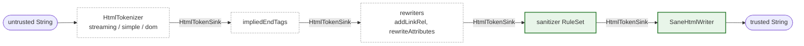

# Design of `package:sanitize_html`

This document explains the opinions baked into the package and why they were
made. The README says what the package does; this says why it is shaped the
way it is, and exactly which code a reviewer has to trust.

## The one idea

Most HTML sanitizers try to *recognize* dangerous input. That means modelling
every quirk of every HTML parser, forever: mutation XSS, tokenizer state
confusion, entity double-decoding, scheme obfuscation. Every new browser
behaviour is a potential bypass.

This package instead only ever *produces* output from a small, closed grammar
in which text cannot become markup. A single writer owns that grammar. Nothing
upstream of it can influence *how* things are written, only *which* things.
So the question "is this input dangerous?" is replaced by "can this output
grammar express anything dangerous?" — a question about a few hundred lines of
our own code, answered once, with references to the spec.

Everything else in the design follows from protecting that property.

## Pipeline



Solid green boxes are the trusted surface. Dashed boxes are untrusted: a bug
there can make output uglier (markup shown as text, content dropped), never
unsafe.

Everything between tokenizer and writer is an `HtmlTransformer`, a function
`HtmlTokenSink Function(HtmlTokenSink next)`. Order matters in exactly one
place: the sanitizer must be last. Everything before it is filtered by the
rules; everything after it would be trusted, so there is nothing after it.

## The trusted surface

The guarantee rests on these files and nothing else. Reviewing the package for
safety means reviewing these.

| File | What it decides | Why it must be trusted |
|---|---|---|
| `lib/src/sane_html_writer.dart` | The output grammar: escaping, name alphabets, void elements, balancing, depth. | It is the only code that writes output. If it is correct, the browser creates no element or attribute that was not pushed into it. |
| `lib/src/url_policy.dart` | Which strings may be the value of a URL attribute. | A `javascript:` URL is a valid attribute value to the writer; only the policy stops it. |
| `lib/src/attribute_rule.dart` | How each `AttributeRule` keeps or drops a value. | It is where the URL policy is actually invoked. A bug here could keep a value the policy rejected. |
| `lib/src/tag_rule.dart`, `lib/src/rule_set.dart` | Which elements have rules, which attributes each keeps, how rule sets combine. | They decide what reaches the writer. |
| `lib/src/grant_assertions.dart` | What a checked `RuleSet()` refuses to allow. | This is the list that turns "the browser creates nothing extra" into "no script runs". |
| `lib/src/gfm_rules.dart` | The default allowlists. | Policy data. No logic, but a wrong entry is a wrong default. |

Explicitly **not** trusted, by design:

* `lib/src/tokenizer/*` — three interchangeable tokenizers. Whatever they
  report, unknown elements are dropped and all text is escaped. They are
  reviewed for termination, linear time and fidelity, not for safety. The
  character-reference decoder is in this group too: the writer re-escapes
  attribute values exactly, so the URL policy sees the same string the
  browser will.
* `lib/src/sanitizer.dart` — trusted for *completeness* (every token that
  reaches the writer passed through the rules), which is a five-line
  argument, not for what it writes.
* `lib/src/implied_end_tags.dart`, `lib/src/rewriters.dart` — cosmetic and
  convenience. They run before the sanitizer and so can only ever add things
  that the rules then filter.

## The promise, stated carefully

> For output inserted where an HTML parser is in the *data state*, the
> browser creates **no element and no attribute that was not pushed into the
> writer**.

It is a *subset* claim, not an equality. A rule set that allows `<plaintext>`
will see the browser turn everything after it into text; one that allows
`<xmp>` will see its content as text. The browser created *fewer* nodes than
we wrote. That is a rendering bug for the author of a strange rule set, not a
safety bug, and the writer deliberately does not try to prevent it. The one
exception is `image`, which the tree builder turns into `img` — an element
nobody pushed — so the writer refuses it, citing
[the spec](https://html.spec.whatwg.org/multipage/parsing.html#the-stack-of-open-elements):

> An image start tag token is handled by the tree builder, but it is not in
> this list because it is not an element; it gets turned into an img element.

The proof sketch lives as the library comment of `sane_html_writer.dart`,
point by point with links to the tokenizer states involved. It is short on
purpose: a 30-minute auditor should be able to follow it end to end.

## Opinions, and why

### The writer owns the grammar, and only the grammar

An earlier iteration had the writer also refuse a list of forbidden elements
(`script`, `style`, ...) and `on*` attributes. It was removed. Two reasons:

* It blurred the argument. "The writer is safe" became "the writer is safe
  given this list", and the list had to be kept in sync with the rules.
* It was the wrong layer. Whether `<script>` is acceptable is a policy
  question; whether `<scr ipt>` can be written is a grammar question. Mixing
  them meant the writer had to know about SVG, forms and `iframe`.

Now the writer's only opinions are: escape text, quote and escape values,
restrict name alphabets, know the void elements, balance, cap depth, refuse
`image`. Everything else is a `RuleSet` decision.

### Names that break the grammar throw

A tag or attribute name outside `[a-z][a-z0-9._-]*` / `[a-z][a-z0-9_:.-]*`
throws `ArgumentError` rather than being skipped. A bad name is a contract
violation by whatever feeds the writer, and throwing surfaces it in tests.
It can never depend on input: a `RuleSet` validates every name at
construction, so the sanitizer only ever passes names the writer accepts
(including the `image` check, which both `RuleSet` constructors share).

### Rules filter; rewriters rewrite

The first prototype had a `modifyAttributes` callback on `TagRule`, used to
add `rel="ugc"` to links. It was removed and `AttributeRule` is now
filtering-only (`tokens` drops individual tokens, which is still filtering).

The problem with a modifier inside the rule set is that its output has to be
re-validated — a modifier can write `href="javascript:..."` — so there was a
second "invariant" pass after every modifier, and the rule set stopped being
declarative. Splitting the concerns made both halves simpler:

* An `AttributeRule` maps a value to *keep* or *drop*. It can be reasoned
  about without running it.
* A rewriter is an ordinary transformer placed *before* the sanitizer. It can
  do anything it likes, because the rules see its output. It needs no trust
  and no knowledge of what is allowed.

The orthogonality is the point: a rewriter that adds ids to headings does not
need to know whether ids are allowed, and a rule set that allows ids does not
need to know where they come from.

### "Baseline" safety is three things, not one

We spent a while on "a baseline rule set that always applies". It turned out
to be three different concerns that want three different mechanisms:

| Concern | Mechanism | Cost |
|---|---|---|
| Output can't be read as anything extra | writer grammar | per character, unavoidable |
| Rules must not grant script execution or host-document control | **grant assertions** at `RuleSet()` construction | zero per document |
| URL values must have a safe scheme | **URL policy**, applied where `AttributeRule.url` is declared | per URL attribute |

The alternative — a runtime "always removed" pass over every attribute of
every element — cost a set lookup per attribute per document to enforce
something that is already decided when the rule set is written.

### Grant assertions are opt-out, and what they cover

`RuleSet(...)` throws `UnsupportedError` for grants that defeat the purpose of
sanitizing; `RuleSet.unsafe(...)` waives them. The list is deliberately about
*security*, not about everything that could look odd:

* **Rejected elements**: `script`, `noscript`, `noembed`, `noframes`
  (execution, and content parsed two ways depending on scripting); `style`,
  `link`, `base`, `meta`, `html`, `head`, `body` (alter the host document,
  not the fragment); `frameset`, `frame`, `form`, `object`, `embed`, `applet`
  (host hijacking, plugins); `isindex` (older parsers, including
  `package:html`, expand it into a `<form>`); `svg`, `math` (foreign content:
  case-sensitive attributes, `<animate>` retargeting `href`, `foreignObject`,
  a long mXSS history).
* **Not rejected**: `plaintext`, `xmp`, `template`, `title`, `textarea`,
  `iframe`. They only make content disappear or render as text. Someone who
  allows them gets a poorly rendering page, not XSS.
* **Rejected attributes**: `on*`, `style`, `srcdoc`, `is`, `form`,
  `formaction`, `formtarget`, `formmethod`, `formenctype`, `ping`,
  `attributionsrc`.
* **URL attributes must be bound explicitly** to `AttributeRule.url` or
  `urlWhere` (`srcset` to `AttributeRule.srcset`). We chose to throw on
  `'href': AttributeRule.any` rather than silently upgrade it, so the policy
  is visible where it is declared and there is one encoding per concept.

### One URL policy, and why not `Uri.parse`

All URL attributes get the same policy: `http`, `https`, `mailto`, or
relative. (An earlier split into "link" and "resource" schemes was dropped:
`mailto:` on an `` is harmless and the split doubled the surface.)

`dart:core`'s `Uri` implements RFC 3986; browsers implement the WHATWG URL
Standard. They disagree precisely where attackers look: browsers strip tab and
newline anywhere and leading/trailing controls before parsing, so
`jav\tascript:alert(1)` is a `javascript:` URL to a browser but a relative
path to `Uri`. The policy therefore mirrors the browser's preprocessing and
then applies a scheme rule that is strictly more conservative than the
browser's: anything before the first `:` that precedes the first `/`, `?` or
`#` is treated as a scheme and must be on the allowlist.

Two further rejections exist so that `AttributeRule.urlWhere`'s `Uri` has the
*host the browser will use*: `\` anywhere (browsers treat it as `/` in special
schemes, `Uri` does not) and userinfo (`https://good.com@evil.com`). Neither
has a legitimate use in sanitized content.

### The token interface is three methods and an eager map

```dart
abstract base class HtmlTokenSink {
  void text(String source, int start, int end);
  void startTag(String name, Map<String, String> attributes);
  void endTag(String name);
}
```

* **Three tokens only.** Comments, doctypes and CDATA are not tokens because
  the writer never emits them. The vocabulary *is* the output grammar, which
  keeps every transformer trivially total.
* **Text is an undecoded source range.** The writer escapes it directly, so
  `&copy;` stays `&copy;` with no decode/re-encode round trip and no
  double-decoding risk.
* **No self-closing flag.** In HTML `/>` only matters for void elements
  (which need no end tag) and foreign content. Tokenizers emit the end tag
  themselves for `<svg/>`/`<math/>`; `<div/>` nests like `<div>`, as in a
  browser.
* **Eager, owned `Map` per tag.** Lazy maps, split begin/attribute/end
  callbacks and per-attribute callbacks were all considered. Profiling showed
  the map is not a hotspot (text copying and `StringBuffer` are), and
  callbacks make every transformer stateful. The sink owns the map and may
  mutate it, so filtering is in place. It is an interface; it could be
  optimised later. It probably will not need to be.

### The sanitizer is almost stateless

Its only state is "which element am I dropping, and how many of them are
nested". It never looks at a stack of open elements. The browser may close
elements where we did not (adoption agency, foster parenting), so any
transformation based on *our* idea of nesting would be a guess — and a guess
in the trusted path is exactly what this design exists to avoid.

Implied end tags (`<p>` closed by `<div>`, `<li>` by `<li>`, ...) are useful
for tidy, idempotent output, so they exist — as a separate, untrusted
transformer that runs *before* the sanitizer, where a wrong guess costs
nothing.

### Two libraries

`package:sanitize_html/sanitize_html.dart` exports seven names:
`htmlSanitizer`, `sanitizeHtml`, `RuleSet`, `TagRule`, `AttributeRule`,
`rewriteAttributes`, `addLinkRel`. That is the whole API for someone
sanitizing Markdown output.

`package:sanitize_html/tokens.dart` exports the building blocks for custom
pipelines: `HtmlTokenSink`, `HtmlTransformer`, `HtmlTokenizer`, `sanitizer`,
`impliedEndTags`, `SaneHtmlWriter`. Casual users never see them.

The primary entry point is a factory, `htmlSanitizer(...)`, returning a
`String Function(String)`. Building rule sets and the transformer chain once
and calling the result many times is the shape we want to encourage;
`sanitizeHtml(html)` is the convenience for the default rules.

### The writer is "sane", not "safe"

It was briefly `SafeHtmlWriter`. Renamed because it is only safe *together
with* a checked rule set: it will happily write `<script>` if asked. What it
guarantees unconditionally is that the output is sane — the browser sees
exactly what was written.

### Package-private operations are extensions, not members

Operations the package needs on exported classes but users should not see
(`TagRule.apply`, `AttributeRule.isUrlRestricted`, `RuleSet.lookup`) are
extension methods in the same `lib/src/` file, never re-exported. Public
classes stay `final` with only their user-facing members, and no `Expando`
or side tables are needed.

## Performance notes

Streaming tokenizer ~20 µs, simple ~21 µs, dom ~116 µs, versus ~99 µs for
v2 (`package:html`) on `benchmark/testdata/lorem-ipsum.md`. The writer copies
unescaped runs with one `substring` per run, `AttributeRule.tokens` returns the
original string when nothing was removed, and the GFM rule set is built once.
Two O(N²) traps were found and fixed (an unbounded `indexOf('&')` per
attribute value, an `indexOf('-->')` per `<` in script data) and are covered
by a regression test; `String.indexOf` in the VM is not `memchr`-fast, so
"scan to the next interesting character" loops are written by hand.

## Deliberately not done

* Cross-attribute conditions (e.g. "`href` only if `rel` contains `ugc`").
  An `AttributeRule` sees one value. Normalize with a rewriter first.
* `data:` image URLs.
* Preserving comments or doctypes.
* The v2 `allowElements` callback (open-ended element names with span-like
  attributes). Compatibility with the v2 `sanitizeHtml` signature is an open
  question, separate from this design.
