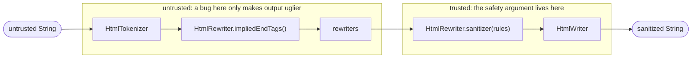

# Design of `package:sanitize_html`

This document explains the opinions baked into the package and why they hold.
The README says what the package does; this says why it is shaped the way it
is, and exactly which code a reviewer has to trust.

## The one idea

Most HTML sanitizers try to *recognize* dangerous input. That means modelling
every quirk of every HTML parser, forever: mutation XSS, tokenizer state
confusion, entity double-decoding, scheme obfuscation. Every new browser
behaviour is a potential bypass.

This package instead only ever *produces* output from a small, closed grammar
in which text cannot become markup. A single writer owns that grammar. Nothing
upstream of it can influence *how* things are written, only *which* things.
So the question "is this input dangerous?" is replaced by "can this output
grammar express anything dangerous?" — a question about a few hundred lines of
our own code, answered once, with references to the spec.

Everything else in the design follows from protecting that property.

## Pipeline



Each arrow is an `HtmlTokenSink`.

Everything between tokenizer and writer is an `HtmlRewriter`: a value that
wraps the next `HtmlTokenSink` in a sink of its own (`bind(next)`). It is a
class rather than a function type so that the built-in rewriters are its
named constructors and a custom one is `HtmlRewriter(MySink.new)`. Order matters in exactly one
place: the sanitizer is last. Everything before it is filtered by the rules;
anything after it would have to be trusted, so there is nothing after it.

## The trusted surface

The guarantee rests on these files and nothing else. Reviewing the package for
safety means reviewing these.

| File | What it decides | Why it must be trusted |
|---|---|---|
| `lib/src/html_writer.dart` | The output grammar: escaping, name alphabets, void elements, balancing, depth. | It is the only code that writes output. If it is correct, the browser creates no element or attribute that was not pushed into it. |
| `lib/src/url_policy.dart` | Which strings may be the value of a URL attribute. | A `javascript:` URL is a valid attribute value to the writer; only the policy stops it. |
| `lib/src/attribute_rule.dart` | How each `AttributeRule` keeps or drops a value. | It is where the URL policy is actually invoked. A bug here could keep a value the policy rejected. |
| `lib/src/element_rule.dart`, `lib/src/rule_set.dart` | Which elements have rules, which attributes each keeps, how rule sets combine. | They decide what reaches the writer. |
| `lib/src/grant_assertions.dart` | What a checked `RuleSet()` refuses to allow. | This is the list that turns "the browser creates nothing extra" into "no script runs". |
| `lib/src/rules/*` | The default allowlists: `gfm.dart`, `html.dart`, `link_types.dart`. | Policy data. No logic, but a wrong entry is a wrong default. |

Explicitly **not** trusted, by design:

* `lib/src/tokenizer/*` — three interchangeable tokenizers. Whatever they
  report, unknown elements are unwrapped and all text is escaped. They are
  reviewed for termination, linear time and fidelity, not for safety. The
  character-reference decoder is in this group too: the writer re-escapes
  attribute values exactly, so the URL policy sees the same string the
  browser will.
* `lib/src/sanitizer.dart` — trusted for *completeness* (every token that
  reaches the writer passed through the rules), which is a five-line
  argument, not for what it writes.
* `lib/src/rewriters/*` — the built-in `HtmlRewriter`s, one per file:
  cosmetic and convenience. They run before the sanitizer and so can only
  ever add things that the rules then filter.
* `lib/src/util/*` — ASCII predicates and the space-separated-token
  splitter. Pure functions used by trusted and untrusted code alike; small
  enough to read in a minute.

Tests mirror this layout: `test/rules/`, `test/rewriters/` and
`test/tokenizer/` for the folders, `test/{sanitize_html,rule_set,
html_writer,url_policy}_test.dart` for the libraries with behaviour of
their own, `test/third_party_cases_test.dart` for cases borrowed from
DOMPurify, html5lib, parse5 and Bleach, and `test/helpers.dart` for the
shared `configured` pipeline and `testContains`/`testNotContains`.

## The promise, stated carefully

> For output inserted where an HTML parser is in the *data state*, the
> browser creates **no element and no attribute that was not pushed into the
> writer**.

It is a *subset* claim, not an equality. A rule set that allows `<plaintext>`
will see the browser turn everything after it into text; one that allows
`<xmp>` will see its content as text. The browser created *fewer* nodes than
we wrote. That is a rendering bug for the author of a strange rule set, not a
safety bug, and the writer deliberately does not try to prevent it. The one
exception is `image`, which the tree builder turns into `img` — an element
nobody pushed — so the writer refuses it, citing
[the spec](https://html.spec.whatwg.org/multipage/parsing.html#the-stack-of-open-elements):

> An image start tag token is handled by the tree builder, but it is not in
> this list because it is not an element; it gets turned into an img element.

The proof sketch lives as the library comment of `html_writer.dart`,
point by point with links to the tokenizer states involved. It is short on
purpose: a 30-minute auditor should be able to follow it end to end.

## Opinions, and why

### The writer owns the grammar, and only the grammar

The writer's only opinions are: escape text, quote and escape values,
restrict name alphabets, know the void elements, balance, cap depth, refuse
`image`. It has no list of forbidden elements and no idea what `on*` means.

Whether `<script>` is acceptable is a *policy* question; whether `<scr ipt>`
can be written is a *grammar* question. Keeping them apart keeps the safety
argument in two independent halves: "the browser sees exactly what was written" holds unconditionally
and is argued from the tokenizer spec alone; "the rules grant nothing
dangerous" holds for checked rule sets and is argued from a short list. If the
writer also carried a forbidden list, the first half would become "the writer
is safe given this list", the list would have to be kept in sync with the
rules, and the writer would need to know about SVG, forms and `iframe`.

### Names that break the grammar throw

A tag or attribute name outside `[a-z][a-z0-9._-]*` / `[a-z][a-z0-9_:.-]*`
throws `ArgumentError` rather than being skipped. A bad name is a contract
violation by whatever feeds the writer, and throwing surfaces it in tests.
It can never depend on input: a `RuleSet` validates every name at
construction, so the sanitizer only ever passes names the writer accepts
(including the `image` check, which both `RuleSet` constructors share).

### Rules filter; rewriters rewrite

An `AttributeRule` maps a value to *keep* or *drop*. It never changes a value,
not even by removing tokens from a `class` list. That makes a rule a plain
predicate on values, and combining rule sets is set algebra:

* `a.union(b)` keeps what either keeps — `a(v) || b(v)`;
* `a.restrict(element, b)` keeps what both keep — `a(v) && b(v)`, which is
  the same as sanitizing with `a` and then with `b`.

Neither needs a special case, and a URL check can never be followed by
something that alters the URL it checked. A rule that removed tokens from a
value would break exactly this: intersected with a URL rule it would split
`http://x/ javascript:alert(1)` on the space *after* the URL check.

Anything that *changes* content — adding `rel="ugc"` to external links, ids
to headings, keeping only some class names — is an `HtmlRewriter`
placed *before* the sanitizer. It may do anything it likes,
because the rules see its output. It needs no trust and no knowledge of what
is allowed.

The orthogonality is the point: a rewriter that adds ids to headings does not
need to know whether ids are allowed, and a rule set that allows ids does not
need to know where they come from.

### "Baseline" safety is three things, not one

There is no single "baseline rule set that always applies". Safety is three
different concerns, each with the mechanism and cost that fit it:

| Concern | Mechanism | Cost |
|---|---|---|
| Output can't be read as anything extra | writer grammar | per character, unavoidable |
| Rules must not grant script execution or host-document control | **grant assertions** at `RuleSet()` construction | zero per document |
| URL values must have a safe scheme | **URL policy**, applied where `AttributeRule.url` is declared | per URL attribute |

A runtime "always removed" pass over every attribute of every element would
spend a set lookup per attribute per document to enforce something that is
already decided when the rule set is written.

### Grant assertions are opt-out, and what they cover

`RuleSet(...)` throws `UnsupportedError` for grants that defeat the purpose of
sanitizing; `RuleSet.unsafe(...)` waives them. The list is deliberately about
*security*, not about everything that could look odd:

* **Rejected elements**: `script`, `noscript`, `noembed`, `noframes`
  (execution, and content parsed two ways depending on scripting); `style`,
  `link`, `base`, `meta`, `html`, `head`, `body` (alter the host document,
  not the fragment); `frameset`, `frame`, `form`, `object`, `embed`, `applet`
  (host hijacking, plugins); `isindex` (older parsers, including
  `package:html`, expand it into a `<form>`); `svg`, `math` (foreign content:
  case-sensitive attributes, `<animate>` retargeting `href`, `foreignObject`,
  a long mXSS history).
* **Not rejected**: `plaintext`, `xmp`, `template`, `title`, `textarea`,
  `iframe`. They only make content disappear or render as text. Someone who
  allows them gets a poorly rendering page, not XSS.
* **Rejected attributes**: `on*`, `style`, `srcdoc`, `is`, `form`,
  `formaction`, `formtarget`, `formmethod`, `formenctype`, `ping`,
  `attributionsrc`.
* **Rejected attributes, host-document control**: `popovertarget`,
  `popovertargetaction`, `command`, `commandfor` (a button operating any
  element on the page by id), `shadowrootmode` (a template becoming its
  parent's shadow root).
* **URL attributes must be bound explicitly** to `AttributeRule.url`
  (`srcset` to `AttributeRule.srcset`). `'href': AttributeRule.any()` throws
  rather than being silently upgraded, so the policy is visible where it is
  declared and there is one encoding per concept.

### One URL policy, and why not `Uri.parse`

All URL attributes get the same policy: `http`, `https`, `mailto`, or
relative. There is no separate "resource" policy for `src`: `mailto:` on an
`` is harmless, and one policy is half the surface of two.

`dart:core`'s `Uri` implements RFC 3986; browsers implement the WHATWG URL
Standard. They disagree precisely where attackers look: browsers strip tab and
newline anywhere and leading/trailing controls before parsing, so
`jav\tascript:alert(1)` is a `javascript:` URL to a browser but a relative
path to `Uri`. The policy therefore mirrors the browser's preprocessing and
then applies a scheme rule that is strictly more conservative than the
browser's: anything before the first `:` that precedes the first `/`, `?` or
`#` is treated as a scheme and must be on the allowlist.

`AttributeRule.url(where)` hands user code a `Uri`, so the policy also
refuses every form where RFC 3986 and the WHATWG parser disagree about the
*host*: `\` anywhere (browsers treat it as `/` in special schemes), anything
but exactly `//` after `http:`/`https:` (browsers skip any number of
slashes, so `https:evil.com` reaches evil.com), userinfo
(`https://good.com@evil.com`) and percent-encoding in the authority
(`e%76il.com`). None has a legitimate use in sanitized content. What remains
— IDN hosts and exotic IPv4 spellings — is passed through literally: a host
*allowlist* is sound, a denylist is not, and the documentation says so. Only
ASCII spaces are stripped at the ends, as the browser does; `String.trim`
would also strip Unicode whitespace that the browser keeps.

### The token interface is three methods and an eager map

```dart
abstract base class HtmlTokenSink {
  void text(String source, int start, int end);
  void startTag(String name, Map<String, String> attributes);
  void endTag(String name);
}
```

* **Three tokens only.** Comments, doctypes and CDATA are not tokens because
  the writer never emits them. The vocabulary *is* the output grammar, which
  keeps every rewriter trivially total.
* **Text is an undecoded source range.** The writer escapes it directly, so
  `&copy;` stays `&copy;` with no decode/re-encode round trip and no
  double-decoding risk.
* **No self-closing flag.** In HTML `/>` only matters for void elements
  (which need no end tag) and foreign content. Tokenizers emit the end tag
  themselves for `<svg/>`/`<math/>`; `<div/>` nests like `<div>`, as in a
  browser.
* **Eager, owned `Map` per tag.** The map is not a hotspot (text copying and
  `StringBuffer` are), and the alternatives — lazy maps, split
  begin/attribute/end callbacks, per-attribute callbacks — make every
  rewriter stateful. The sink owns the map and may mutate it, so filtering
  is in place. It is an interface; it could be optimised later.

### The sanitizer is almost stateless

Its only state is "which element am I dropping, and how many of them are
nested". It never looks at a stack of open elements. The browser may close
elements where we did not (adoption agency, foster parenting), so any
transformation based on *our* idea of nesting would be a guess — and a guess
in the trusted path is exactly what this design exists to avoid.

Implied end tags (`<p>` closed by `<div>`, `<li>` by `<li>`, ...) are useful
for tidy, idempotent output, so they exist — as a separate, untrusted
rewriter that runs *before* the sanitizer, where a wrong guess costs
nothing.

### Depth is capped the way Blink caps it

Blink stops nesting at 512 (`kMaximumHTMLParserDOMTreeDepth`): a deeper
element is attached as a sibling of the innermost one. Three stacks in the
pipeline are bounded the same way, with two constants: the writer caps the
*output* at 128 — Blink's limit counts the host document's depth, which we
cannot know, and a quarter leaves any plausible host room so the browser
never flattens sanitized output itself — and the sanitizer uses the writer's
constant because its stack approximates the writer's; `impliedEndTags`
caps at 512 because it imitates Blink on the *input*. A start tag at the cap closes the innermost open element and takes its
place. Nothing is dropped, nothing is counted, every stack stays bounded, so
every scan of a stack is O(1) and the pipeline is linear in the input. The
alternative — swallowing start tags beyond the cap and counting their end
tags — desynchronizes: a swallowed `</p>` can be paid for by a swallowed
`<b>`, leaving a `</p>` in the output that the browser answers with an empty
`<p>` nobody pushed.

### Elements the rules do not keep are unwrapped

An element without a rule or matching pattern loses its tags and keeps its
content, which the rules then judge on its own. This
is what every Markdown-oriented sanitizer does (html-pipeline, hast,
ammonia, DOMPurify, bluemonday), and it follows from what rules are for:
they say what is *safe* to keep, not what the output should *look* like.
Dropping `<x>a</x>` entirely would make the rule set a styling tool and
would lose the author's text for no safety gain — the text is escaped
either way. Callers who want subtrees gone run
`HtmlRewriter.dropElements({...})` *before* the rules, where a wrong guess
costs nothing.

Unwrapping has one consequence for the sanitizer: whether an element is
kept can depend on its attributes (a pattern may be the only thing allowing
it), so the same name may be kept once and unwrapped the next time, and the sanitizer must know which end tag
belongs to which. It keeps a stack of the start tags it has seen, matching
end tags against it exactly as the writer does (nearest open element of
that name, otherwise ignored), capped at the writer's depth. Closing a
kept element pops everything above it, as it does in the writer; closing
an unwrapped element pops only itself, since the writer has nothing to
close. A disagreement between this stack and the writer's can only
misplace a closing tag.

### Rules filter attributes; patterns are exemptions

An `ElementRule` decides each attribute on its own and always keeps the
element. That independence is what makes rule sets compose: a union keeps an
attribute if either rule keeps it, an intersection if both do, and nothing
else needs saying. (The union is a hull — `<b title lang>` survives a union
of "`b` with `title`" and "`b` with `lang`" although neither alone would
keep both — and that is the behaviour wanted: *allow what either allows*,
per attribute.)

"An `<iframe>` only from this origin and only sandboxed" is not a
per-attribute decision, and every attempt to express it inside a rule —
a required-attribute set, a required flag per attribute, a predicate over
the attribute map — broke composition the same way: after a union the
requirement was judged against the *merged* rule for `src`, so a frame
from the other side's origin satisfied it. Requirements and per-attribute
merging do not mix.

So exact forms are a separate thing, an `ElementPattern`: a tag name, the
attributes that must be present and pass, and the attributes kept if
present. A pattern is judged on the element as written with its own rules,
and it is never merged. A rule set holds, per tag, one rule and an ordered
list of patterns; the first matching pattern decides, otherwise the rule.
Composition follows:

* `union` ORs the rules per attribute and concatenates the pattern lists,
  this rule set's first. Order only decides which of two matching patterns
  speaks — a small price for having no merge at all.
* `without(elements)` removes an element's rule and its exemptions. An
  exemption is an exception to the rules for its element; without the
  element there is nothing to except.
* `restrict(element, rule)` ANDs the named attributes of one element's rule
  and leaves everything else — other attributes, other elements, all
  exemptions — as it is. It can only narrow, so the call site says what it
  does.

There is no `intersection` of two rule sets. Every narrowing anyone asks
for is "this default minus a few elements" or "this attribute, tighter";
an intersection with a hand-written rule set would mean re-listing every
element to keep, and the intersection of two full rule sets (`gfm` with
`html`, say) is a set nobody wants. Capping one rule set by another is the
pipeline, and is spelled as such: `HtmlRewriter.sanitizer(a)` followed by
`HtmlRewriter.sanitizer(b)`. Exemptions do not survive any of this on
their own merits — `union` carries them, `without` drops them with their
element, `restrict` ignores them — because they do not compose: an
exemption is an exception to *these* rules, and there is no principled
exception to a combination of rule sets that is not simply one of the
originals.

### RAWTEXT and template content is dropped

The streaming and simple tokenizers emit no text for the content of `xmp`,
`textarea`, `title`, `iframe` and the other RAWTEXT/RCDATA elements. Passing
it through would be wrong: the writer escapes `<` as `&lt;`, and inside
`<xmp>` a browser does not decode character references, so the reader would
see a literal `&lt;`. A rule set that allows these elements gets them empty.
`<template>` content is skipped for a different reason: the browser parses
it into an inert fragment that never renders, so unwrapping a `<template>`
must not make its content live.

### The default rule sets are somebody else's opinion

Which elements are *safe* is settled by the writer and the grant
assertions; which elements a host should *allow* is taste, and this package
ships as little of its own as it can. Each default rule set is anchored to
a maintained external document and deviates only where this package's
checks force it or where the source leaves a check to its callers — and
every rule carries a comment naming its source.

* `RuleSet.gfm()` is for rendered Markdown: html-pipeline's allowlist (the
  open-source origin of GitHub's pipeline) plus exactly what
  `package:markdown` emits for `ExtensionSet.gitHubWeb`. It has no
  parameters. The attributes a Markdown renderer needs that reach into the
  host page get the narrowest rule that still serves the renderer: `id`
  only in the `user-content-` namespace, which GitHub, GitLab and Gitea use
  for the same reason (an author id can shadow `window.getElementById` or
  the host's own ids) and which `package:markdown` is expected to emit;
  `class` only with `markdown-*` tokens, and `language-*` on `<code>`;
  `name` not at all. `<input>` is allowed only as a checkbox, through a
  pattern.
* `RuleSet.html()` is for arbitrary HTML: the tables of Google's
  safevalues sanitizer, verbatim, because its principle is this package's
  — keep what cannot reach outside the content — and because it is public
  and maintained. The deviations are the URL policy, the `rel` allowlist,
  `target`/`dir`/`loading` as enumerations, and no `<link>` or
  `formenctype`, all forced by the constructor — plus one opinion of this
  package's own, applied to the end of safevalues' table rather than
  invented: seven things that bind the content to something the host owns
  (`autofocus` to its focus, `download` to its navigation, `itemref` and
  `usemap` to its ids, `required` to its form, `slot` and `<slot>` to its
  shadow tree) are dropped, with the reason for each in the source. Content
  that composes with the host by nesting — a heading in its outline, an
  `itemprop` in an enclosing item, a `<select>` in an enclosing form — is
  what embedding HTML means, and is kept.
* `ElementPattern.iframe(where:, sandbox:)` exists because "everything
  except iframes from these origins" is the request every host makes next,
  and `ElementPattern.checkbox` because it is the one `<input>` form that
  can do nothing. Both are patterns to add with `withExemptions`.

The version 2 parameters survive as deprecated sugar over these pieces, so
old calls compile and mean the same.

### One library

`package:sanitize_html/sanitize_html.dart` exports nine names. Six are the
API for someone sanitizing Markdown output: `sanitizeHtml`, `RuleSet`,
`ElementRule`, `ElementPattern`, `AttributeRule`, `HtmlRewriter`. Three are
the pipeline parts
for custom pipelines: `HtmlTokenizer`, `HtmlTokenSink`, `HtmlWriter`; together
with `HtmlRewriter.sanitizer` and `HtmlRewriter.impliedEndTags` they are
enough to assemble `sanitizeHtml` by hand.

They share one library because the boundary leaks: `sanitizeHtml` takes an
`HtmlTokenizer`, and a custom `HtmlRewriter` is built from an `HtmlTokenSink`.
A second import for a documented parameter is a worse experience than three
extra names with a shared `Html` prefix.

The entry point is one function, `sanitizeHtml(html, {rules, rewriters,
tokenizer})`. There is nothing to build up front: all validation happens
when a `RuleSet` is constructed, and the default rule set is built once, so a
"create a sanitizer, then call it" API would only add a step.

### The writer is not called "safe"

`HtmlWriter` is only safe *together with* a checked rule set: it will
happily write `<script>` if asked. What it guarantees unconditionally is that
the browser sees exactly what was written — no more. A name promising safety
would overstate it.

### Package-private operations are extensions, not members

Operations the package needs on exported classes but users should not see
(`ElementRule.apply`, `AttributeRule.isUrlRestricted`, `RuleSet.lookup`) are
extension methods in the same `lib/src/` file, never re-exported. Public
classes stay `final` with only their user-facing members, and no `Expando`
or side tables are needed.

## Performance notes

Streaming tokenizer ~20 µs, simple ~21 µs, dom ~116 µs on
`benchmark/testdata/lorem-ipsum.md`. The writer copies unescaped runs with one
`substring` per run, attribute rules never allocate when they keep a value,
and the GFM rule set is built once. `String.indexOf` in
the VM is not `memchr`-fast, so "scan to the next interesting character" loops
are written by hand and every scan is bounded by the current token; a
regression test checks that pathological inputs stay linear.

## Deliberately not done

* Cross-attribute conditions (e.g. "`href` only if `rel` contains `ugc`").
  An `AttributeRule` sees one value. Normalize with a rewriter first.
* `data:` image URLs.
* Preserving comments or doctypes.
* Callback-style element allowlists (`bool Function(String tagName)`).
  Element names are declared up front so that every name can be validated,
  and every grant asserted, at construction.
